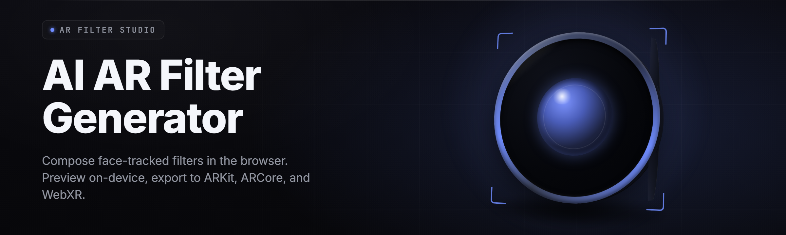

  
  
  

  

  
  
  

---

**AI AR filter generator for Windows — build, train, and hot-swap live face filters from a single `.exe`. Version 2026.1.**

> **ar-filter-studio** — a desktop AR filter studio and toolkit that turns any webcam into a real-time AI-driven filter rig. Face tracking, generative filters, filter packs, and a full local inference stack. Everything ships in one `.exe`. No drivers to fight, no cloud calls, no Python environment.

| Module | Status | Description |
|--------|--------|-------------|
| `facetrack-core` | ✅ Working | 468-point dense face mesh @ 120fps on any modern webcam |
| `filter-runtime` | ✅ Working | Realtime filter compositor, GPU-accelerated |
| `gen-face-styler` | ✅ Working | Diffusion-based generative filter engine, on-device |
| `pack-loader` | ✅ Working | Hot-swaps filter packs without restarting the runtime |
| `live-swap` | ✅ Working | Swap filters mid-call, mid-stream, mid-meeting |
| `occlusion-solver` | ✅ Working | Hand/object occlusion over the face mesh |
| `lit-estimator` | ✅ Working | Relights generative filters to match scene lighting |
| `record-pipe` | ✅ Working | Direct to OBS / MP4 / virtual camera |

---

## 🧭 Table of Contents

- [Overview](#-overview)
- [What is an AI AR filter generator?](#-what-is-an-ai-ar-filter-generator)
- [Compatibility](#-compatibility)
- [Usage guidelines — Allowed / Not allowed](#-usage-guidelines--allowed--not-allowed)
- [System Requirements](#-system-requirements)
- [Module catalog](#-module-catalog)
  - [🎭 Face tracking & mesh](#-face-tracking--mesh)
  - [🎨 Generative filter domain](#-generative-filter-domain)
  - [🧩 Filter pack domain](#-filter-pack-domain)
  - [📡 Streaming & capture domain](#-streaming--capture-domain)
  - [🛠️ Authoring & training domain](#️-authoring--training-domain)
  - [⚙️ Runtime, debug & ops](#️-runtime-debug--ops)
- [Quick Start](#-quick-start)
- [Installation](#-installation)
- [Known Issues](#-known-issues)
- [Changelog (2026.1)](#-changelog-20261)
- [FAQ](#-faq)

---

## 📊 Overview

| Category | Details |
|----------|---------|
| Product | `ar-filter-studio` — AI AR filter generator + runtime |
| Release | v2026.1 (Windows x64) |
| Engine | Local GPU inference, ONNX + custom CUDA/Vulkan kernels |
| Input | Any UVC webcam, capture card, or virtual camera source |
| Output | Preview window, virtual camera device, MP4, stream |
| Filter format | `.arx` packs (weights + graph + meta) |
| Tracking | 468-point face mesh, iris, head pose, expression blendshapes |
| Distribution | Single `.exe`, portable, no install ceremony |
| Footprint | ~1.4 GB on disk with base filter pack installed |

`ar-filter-studio` is a self-contained Windows desktop application that turns a webcam feed into a live generated-AR surface. You launch one `.exe`, pick a filter pack, and the runtime applies a neural filter to your face in real time — no browser, no cloud, no per-frame upload. Filters are generated, not just overlaid: the engine actually synthesizes the visuals over your face mesh at frame rate, then composites and relights them so they sit in the same light as the room around you.

---

## 🧠 What is an AI AR filter generator?

| Term | Explanation |
|------|-------------|
| **AR filter** | A visual layer rendered onto a tracked surface (usually a face) in a live camera feed. |
| **Filter pack (`.arx`)** | A portable bundle containing a filter graph, model weights, and metadata. Droppable into the runtime. |
| **Face mesh** | The dense set of landmark points the engine uses to know where your face is, how it's posed, and how it's shaped. |
| **Generative filter** | A filter whose pixels are *synthesized* by a neural net per frame, not stamped from a static PNG overlay. |
| **Hot-swap** | Changing filters live, mid-stream, without restarting the runtime or dropping the camera session. |
| **Relight** | Inferring scene light direction/color and applying it to a generative filter so it matches the room. |
| **Virtual camera** | A device the studio exposes to other apps (OBS, Discord, Zoom, Teams) that carries the filtered feed. |
| **Filter graph** | The directed node graph in an `.arx` pack: tracking → generate → relight → composite → output. |

Five reasons people run this instead of a web filter app:

- **Local-only inference** — nothing leaves your machine, no upload per frame, no account.
- **Generative, not painted** — filters that synthesize skin, holograms, creature faces, stylized paint.
- **Hot-swappable** — a live stream never has to stop for a filter change.
- **Pack-driven** — the filter set grows by dropping `.arx` files into a folder.
- **Frame-rate native** — built to hold 60fps on a mid-tier GPU, not to impress a spec sheet.

---

## 🖥️ Compatibility

| Platform | Supported | Notes |
|----------|-----------|-------|
| Windows 11 (x64) | ✅ Full | Primary target, best tracking perf |
| Windows 10 (21H2+) | ✅ Full | Requires latest GPU driver |
| Windows on ARM | ⚠️ Partial | x64 emulation; no CUDA path |
| macOS | ❌ Not shipped | Runtime is Windows-first |
| Linux | ❌ Not shipped | Community build not maintained |
| Browser / web | ❌ N/A | This is a desktop `.exe` |
| GPU (NVIDIA RTX 20/30/40/50) | ✅ Full | CUDA backend, fastest |
| GPU (AMD RX 6000/7000) | ✅ Supported | Vulkan/DirectML backend |
| GPU (Intel Arc) | ✅ Supported | DirectML backend |
| CPU-only | ⚠️ Partial | ~15–20fps, fine for preview |

Works with any UVC camera: laptop webcams, Logitech/Brio, capture cards, and virtual camera sources. Also accepts a video file as input for offline filter preview and pack authoring.

---

## 🧾 Usage guidelines — Allowed / Not allowed

| Allowed | Not allowed |
|---------|-------------|
| Personal streaming, recording, and video content with AI AR filters | Using another person's face or likeness without consent |
| Building and sharing your own `.arx` filter packs | Redistributing proprietary filter packs you don't own |
| Using the virtual camera in OBS, Discord, Zoom, Teams, games | Using the tool to deceive in identity-verified contexts (KYC, legal ID, notarized video) |
| Authoring stylized/character filters for entertainment | Generating real-person deepfake faces of minors |
| Research on face tracking, relighting, and generative compositing | Circumventing the licensing check on commercial filter packs |
| Offline preview and pack benchmarking | Reverse-engineering packs sold by other authors for resale |

---

## 🧱 System Requirements

| Component | Minimum | Recommended |
|-----------|---------|-------------|
| OS | Windows 10 21H2 (x64) | Windows 11 23H2+ |
| CPU | 4-core @ 2.8GHz | 8-core @ 3.6GHz+ |
| RAM | 8 GB | 16 GB+ |
| GPU | 4 GB VRAM, DirectX 12 | 8 GB+ VRAM (RTX 3060 / RX 6700 / Arc A750+) |
| Disk | 2 GB free | 8 GB free (filter pack headroom) |
| Camera | any UVC, 720p30 | 1080p60 external |
| Driver | latest GPU driver | latest Studio driver (NVIDIA / AMD Pro) |
| Runtime | .NET 8 desktop (bundled) | — |

---

## 🧩 Module catalog

### 🎭 Face tracking & mesh

Tracking is the spine of the whole tool. Every filter decision — pose, blendshape, occlusion, and relight — is downstream of the mesh the tracker produces this frame. The tracker runs at the frame cadence of the camera and feeds a lock-free ring buffer into the filter runtime so the generative pass never stalls waiting on tracking.

- **`facetrack-core`** — 468-point dense mesh, iris landmarks, head pose at 120fps on modern webcams.
- **`blendshape-solver`** — 52 expression coefficients, drives filter parameters directly.
- **`iris-tracker`** — precise pupil center, used for gaze-reactive filters.
- **`mesh-smoothing`** — temporal smoothing pass, kills per-frame jitter.
- **`multi-face`** — track and filter up to 4 faces in frame simultaneously.
- **`occlusion-solver`** — recognises hands/objects crossing the face and de-renders the filter there.
- **`track-recovery`** — instant re-acquire after the face leaves and re-enters frame.

### 🎨 Generative filter domain

This is where the "AI" in the name actually lives. Generative filters don't load a PNG and stamp it — they run a small conditional diffusion or GAN pass that renders the filter pixels conditioned on your mesh, expression, and predicted lighting. The engine then composites the generated frame back over the tracked region.

- **`gen-face-styler`** — on-device face stylization model, 30ms/frame at 1080p on an RTX 3060.
- **`gen-material-pass`** — synthesizes skin, metal, fur, or hologram material over the mesh.
- **`gen-paint-brush`** — stylized painterly filter that re-renders the face as brushwork.
- **`gen-creature-pass`** — creature face filters (scales, feathers, chitin) with adjustable intensity.
- **`gen-age-shift`** — bidirectional age mapping, ±25 years, tunable.
- **`style-transfer-chain`** — chainable style graphs for stacked filters.
- **`diffusion-seed-lock`** — lock a seed so a filter looks identical across sessions.
- **`gen-latent-cache`** — caches the last N latents to avoid redundant compute on near-identical frames.

### 🧩 Filter pack domain

Packs are the unit of distribution. An `.arx` pack is a zip-like container with a graph JSON, a weights file, and metadata. The studio exposes a pack folder and watches it — drop a pack in and it appears in the library without a restart.

- **`pack-loader`** — loads and validates `.arx` packs at runtime.
- **`pack-hot-swap`** — swap live filters without stopping the camera session.
- **`pack-hierarchy`** — layered packs (base + overrides) with additive blending.
- **`pack-preview-grid`** — instant 4-up preview of any pack before activating it.
- **`pack-metadata`** — author name, version, compatible engine range, and required VRAM.
- **`pack-signing`** — optional Ed25519 signing for pack provenance.
- **`pack-lint`** — validates graphs and weights before a pack can be published.

### 📡 Streaming & capture domain

The point of a live filter is being able to send it somewhere. This domain is how the filtered frame leaves the studio — as a virtual camera, as an MP4, or pushed straight into a streaming tool.

- **`record-pipe`** — record the filtered feed directly to MP4 with audio from any input device.
- **`virtual-camera`** — exposes "AR Filter Studio Camera" as a DirectShow device.
- **`obs-bridge`** — one-click virtual camera preset for OBS.
- **`stream-overlay`** — a transparent window that captures the filtered feed for stream overlays.
- **`frame-tap`** — a debug tap that pumps raw + filtered frames out for external tools.
- **`ndi-out`** — optional NDI output for network-attached capture.
- **`rtmp-push`** — direct RTMP push for going live without OBS.

### 🛠️ Authoring & training domain

You don't have to consume filters — you can author them. The authoring side of the studio embeds a training/inference harness so you can fine-tune a personal filter on a handful of frames and export it as an `.arx` pack.

- **`filter-graph-editor`** — node-graph editor for filter pipelines (tracking → gen → composite).
- **`lora-finetune`** — small LoRA fine-tune on your own frames, exports into a pack.
- **`dataset-capture`** — captures tracking-aligned frames into a training set.
- **`graph-simulator`** — dry-run a graph on a recorded video before going live.
- **`weight-optimizer`** — quantizes generated weights for lower VRAM with minimal quality loss.
- **`pack-exporter`** — packages a constructed graph + weights into `.arx`.
- **`graph-diff`** — shows what changed between two versions of a filter graph.

### ⚙️ Runtime, debug & ops

Everything that keeps the whole thing honest: telemetry that stays local, per-frame timing, GPU fallback, crash recovery.

- **`perf-hud`** — realtime per-stage timing (track / gen / relight / composite).
- **`gpu-fallback`** — clean swap to DirectML/CPU when the primary backend errors.
- **`local-telemetry`** — logs to disk only. No network calls by design.
- **`crash-recovery`** — restores the last active filter graph after an unclean exit.
- **`profile-switcher`** — save/restore full studio profiles (filter + cam + output).
- **`autostart-relight`** — sets relight on by default for generative packs.
- **`runtime-flags`** — CLI flags for launching straight into a filter or pack-folder.

---

## ⚡ Quick Start

1. **📁** Visit the project page and grab the release from the download section.
2. **🗜️** Extract the archive to any folder you own (avoid `Program Files` to skip permission prompts).
3. **▶️** Run the `.exe`. On first launch it copies the bundled base filter pack into your pack folder.
4. **🎥** Pick your camera from the source dropdown. The preview should start with a live face mesh overlay.
5. **🎭** Select a filter from the pack library — it applies instantly, hot-swapped.
6. **📡** Enable **Virtual Camera** (or **Record to MP4**) when you're ready to send the feed somewhere.

---

## 📦 Download

  

---

## 🧲 Installation

1. **Get the release.** From the project page, head to the download section and grab the current Windows release. It ships as a single portable archive — no installer, no dependencies.
2. **Extract it.** Unpack anywhere on your disk. The `.exe` and its `packs/` and `models/` folders should sit side by side. Keep them together; the runtime looks for packs relative to the `.exe`.
3. **First run.** Double-click the `.exe`. Windows may show a SmartScreen prompt for a fresh unsigned build — that's expected for pre-[insert-release] binaries; click through if you trust the source. On first launch the studio auto-detects your camera, picks the best GPU backend, and seeds the default filter pack.

After the first run you'll find your pack folder under the same directory. Any `.arx` pack dropped in there appears in the library on the next frame — no restart.

---

## 🩹 Known Issues

| Issue | Solution |
|-------|----------|
| Preview is black on first launch | Camera in use by another app — close it, then hit **Rescan cameras** |
| Tracking loses lock when face is at extreme angles | Enable **track-recovery** in Settings, or lower camera FOV slightly |
| Generative filter is heavy on VRAM | Set `gen-latent-cache` on and lower pack resolution to 720p in pack settings |
| Virtual camera not visible in Zoom/Teams | Restart the app after enabling the virtual camera device; some apps only list devices at launch |
| Filters look mismatched to room light | Turn on **relight** in the filter panel and pick the correct light direction manually |
| Pack fails to load with "graph version mismatch" | Update to a pack built for the current engine range, or run `pack-lint` to see the exact field |

---

## 🗒️ Changelog (2026.1)

- Added `gen-creature-pass` with feather and chitin material synthesis.
- `pack-hot-swap` now preserves expression state across a swap.
- Reduced generative VRAM peak by ~18% via smarter latent caching.
- New `graph-diff` tool for pack authors.
- Virtual camera exposes 720p60 alongside 1080p30.

---

## ❓ FAQ

**Q:** Is this a web tool or a desktop app?
**A:** Desktop. It's a Windows `.exe`. You download, extract, and run it. No browser, no accounts.

**Q:** Does it work with Zoom, Teams, Discord, and OBS?
**A:** Yes. Enable the virtual camera and any app that accepts a webcam can use the filtered feed. OBS has a one-click preset.

**Q:** Do my frames get uploaded anywhere?
**A:** No. Inference and telemetry are local. The runtime is designed to keep the camera feed on-disk and on-GPU.

**Q:** Can I make my own filters?
**A:** Yes. The authoring stack includes a node-graph editor, LoRA fine-tuning on your own frames, and a pack exporter to ship your filter as an `.arx`.

**Q:** How heavy is a generative filter on my GPU?
**A:** On an RTX 3060 at 1080p, a stylization pass runs around 30ms per frame. CPU-only mode is closer to 15–20fps and intended for preview.

**Q:** Does it work on Steam?
**A:** The studio itself doesn't ship on Steam — it's a standalone release. It coexists fine with Steam games through the virtual camera.

**Q:** Why is the tracking so smooth compared to web filters?
**A:** Dense mesh plus a temporal smoothing pass plus a lock-free buffer between tracker and runtime. The tracker never waits on the renderer.

**Q:** Where do I get new filter packs?
**A:** Drop any `.arx` pack into the pack folder and it appears live. The community publishes packs; the authoring tool lets you make your own.

---

The current build is tuned to hold frame rate on mid-tier GPUs first, and to expose every stage so you can see exactly where time is going. If you're authoring packs, start with `graph-simulator` on a recorded clip before going live — it's the fastest way to iterate on a filter without fighting the camera. Everything else is one `.exe`, one pack folder, one live feed.

  

